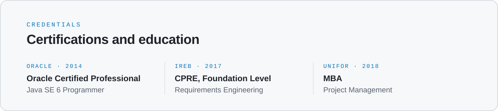

<picture>
  <source media="(prefers-color-scheme: dark)" srcset="assets/header-dark.svg">
  
</picture>

<picture>
  <source media="(prefers-color-scheme: dark)" srcset="assets/stack-dark.svg">
  
</picture>

<picture>
  <source media="(prefers-color-scheme: dark)" srcset="assets/credentials-dark.svg">
  
</picture>

  <a href="https://willamesyano.github.io"><picture><source media="(prefers-color-scheme: dark)" srcset="assets/website-dark.svg"></picture></a>&nbsp;&nbsp;<a href="https://linkedin.com/in/willamesyano"><picture><source media="(prefers-color-scheme: dark)" srcset="assets/linkedin-dark.svg"></picture></a>&nbsp;&nbsp;<a href="https://x.com/willamesyano"><picture><source media="(prefers-color-scheme: dark)" srcset="assets/x-dark.svg"></picture></a>

